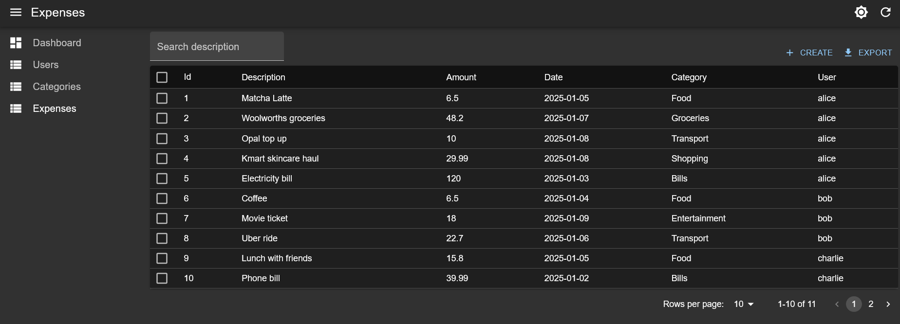
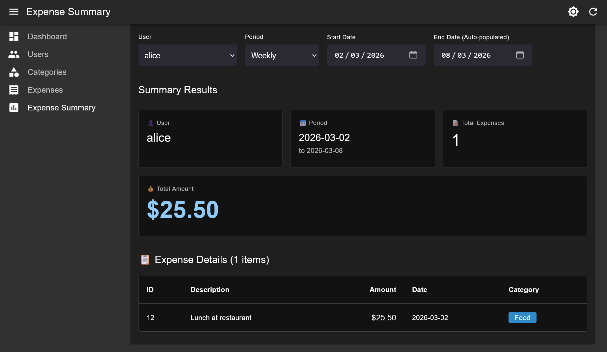

# ExpenseWise Frontend (React + React Admin)


This is the frontend UI for ExpenseWise, a simple personal expense tracking dashboard.

The frontend is built using React, Vite, and React Admin, and provides a clean admin-style interface for managing Users, Categories, and Expenses.

The application's security architecture was enhanced by integrating with a standalone Go Authentication service, ensuring clean separation between UI state management and backend identity protocols.

- Backend: https://github.com/alicengalice/expense-wise-backend
- Go Auth Service: https://github.com/alicengalice/go-auth-service/

## Tech Stack

* **React 19**
* **Vite 7**
* **TypeScript**
* **React Admin 5**
* **Material UI** (via React Admin)
* **ra-data-simple-rest** (REST data provider)
* **Axios** (custom API calls)

## Project Structure

* `App.tsx`: React Admin root: resources, data provider and the fetch client that adds the JWT to requests
* `main.tsx`: Vite app entry
* `api.ts`: Axios instance for custom calls (dashboard, expense summary), with an interceptor that adds the JWT
* `auth/authProvider.ts`: login, logout and auth checks for React Admin (talks to the Go auth service)
* `auth/token.ts`: one place to read/store the token, check expiry and build the `Authorization` header
* `resources/`: CRUD screens for Users, Categories, Expenses, plus the Expense Summary page
* `dashboard/`: Home page
* `utils/paramTransformer.ts`: converts React Admin's paging/sorting params to the backend's `_start`/`_end`/`_sort`/`_order`

```
src/
  App.tsx
  main.tsx
  api.ts
  auth/
  dashboard/
  resources/
  utils/
  assets/
```

## Features

* Login / logout against the Go auth service; expired tokens send you back to the login page
* View, create, edit, and delete Users
* Manage Categories
* Manage Expenses
* Expense Summary: daily, weekly (up to 7 days) or monthly totals per user
* Auto-generated table and form UI
* Pagination and sorting (handled by React Admin)
* Integrates directly with the Spring Boot backend

## API Configuration

The service URLs are currently hardcoded:

| Service | URL | Set in |
|---|---|---|
| Backend API | `http://localhost:8080/api` | `src/App.tsx`, `src/api.ts` |
| Go auth service | `http://localhost:8081` | `src/auth/authProvider.ts` |

## Running the Frontend

### Prerequisites
* Node.js
* The [backend](https://github.com/alicengalice/expense-wise-backend) running on port 8080
* The [Go auth service](https://github.com/alicengalice/go-auth-service/) running on port 8081

### 1. Install dependencies

```
npm install
```

### 2. Start the dev server

```
npm run dev
```

The application will run at `http://localhost:5173`. Log in with the admin username and password configured in the Go auth service (`ADMIN_USERNAME` / `ADMIN_PASSWORD`).

### Other scripts

```
npm run build    # type-check and production build
npm run lint     # ESLint
```

## Pages Included

### Login

* Default React Admin login page, backed by `authProvider`

### Users

* UserList
* UserCreate
* UserEdit

### Categories

* CategoryList
* CategoryCreate
* CategoryEdit

### Expenses

* ExpenseList
* ExpenseCreate
* ExpenseEdit

### Expense Summary

* ExpenseSummaryPage

## Demo

* Expenses Table


* Expenses Summary


## Connecting Backend + Frontend

The frontend uses these backend endpoints:

```
GET/POST/PUT/DELETE /api/users
GET/POST/PUT/DELETE /api/categories
GET/POST/PUT/DELETE /api/expenses
GET /api/expenses/summary/{daily|weekly|monthly}/...
```

The CRUD screens use the React Admin REST provider; the summary page uses Axios.

### Authentication

1. The login page sends the username and password to the Go auth service (`POST /login`) and stores the returned JWT in `localStorage`.
2. Every backend request carries `Authorization: Bearer <token>`.
3. If the token is missing or expired, or the backend answers `401`/`403`, the token is cleared and you're sent back to the login page.

See the [Go auth service README](https://github.com/alicengalice/go-auth-service/) for the full flow.

## Running the Full Stack

Start the services in this order:

| # | Service | Port | How |
|---|---|---|---|
| 1 | PostgreSQL | 5432 | Local install or Docker, with an `expensewise` database |
| 2 | [Backend](https://github.com/alicengalice/expense-wise-backend) | 8080 | `./gradlew bootRun` (see its README for `.env`) |
| 3 | [Go auth service](https://github.com/alicengalice/go-auth-service/) | 8081 | `go run .` (see its README for `.env`) |
| 4 | Frontend | 5173 | `npm run dev` |

The backend's `AUTH_JWT_SECRET` and the auth service's `JWT_SECRET` must be the same value, otherwise every API call returns `401`.

## Improvements
:white_check_mark: Fixed expense create/update payload mapping to consistently send categoryId and userId, preventing server communication errors during expense creation (4th May 2026)

:white_check_mark: Improved auth/login error handling to surface actionable network/service errors instead of generic invalid credential messages (4th May 2026)

:white_check_mark: Centralised token handling in `auth/token.ts` and made expired tokens log the user out straight away (21st Nov 2026)
